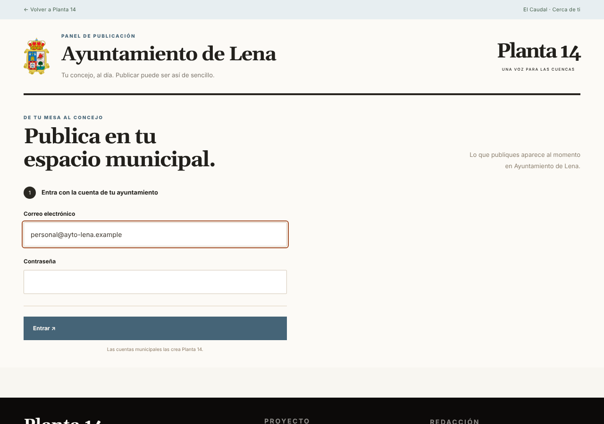
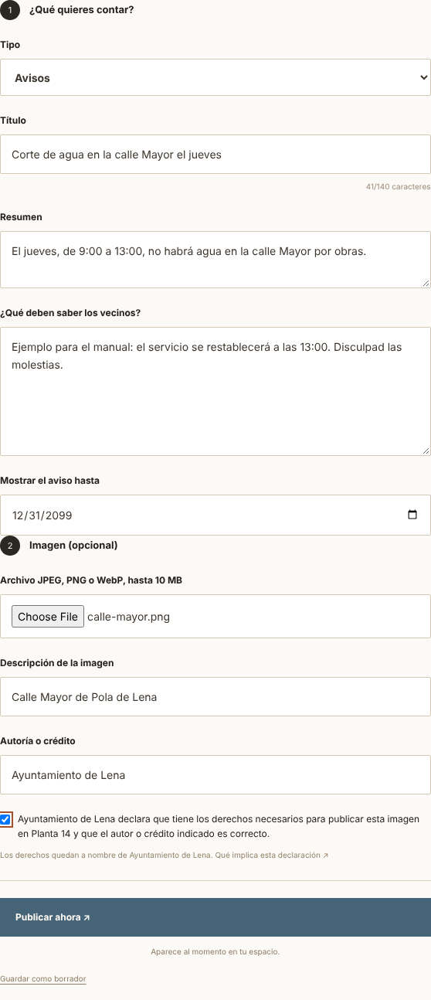
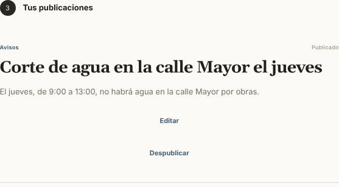
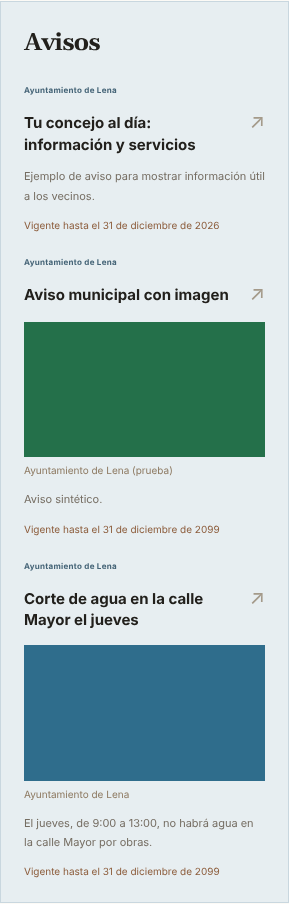
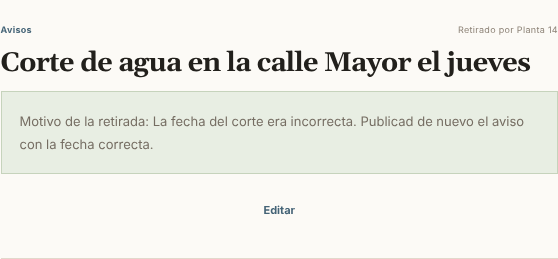

# Cómo publicar en tu espacio de Planta 14

Guía rápida para el personal del ayuntamiento. Si tienes dudas, escribe a **info@planta14.com** o llama al **985 69 35 04**.

## 1. Entrar

1. Abre la dirección de tu espacio seguida de `/panel`. Por ejemplo, para Lena: `planta14.com/lena/panel`.
2. Escribe el correo y la contraseña de tu cuenta y pulsa **Entrar**.

La cuenta te la da Planta 14 y es solo para ti: no la compartas. Si crees que alguien conoce tu contraseña, avísanos.

**¿Has olvidado tu contraseña?**
1. En la pantalla de entrada, pulsa **«¿Has olvidado tu contraseña?»** y escribe tu correo.
2. Recibirás un correo de Planta 14 con un enlace. Sirve una vez y caduca en una hora; si no lo ves, mira en el correo no deseado.
3. El enlace abre tu panel. Escribe la contraseña nueva dos veces (al menos 12 caracteres) y entrarás directamente.

## 2. Publicar un aviso

1. En **Tipo**, elige *Avisos* (o noticia, agenda, ayuda o anuncio).
2. Escribe el **título**, un **resumen** corto y el **texto** completo.
3. Indica hasta qué día debe verse el aviso. Después desaparece solo.
4. Pulsa **Publicar ahora**. Aparece al momento en tu espacio.

Si todavía no está listo, pulsa **Guardar como borrador**: solo lo ve tu ayuntamiento.

## 3. Añadir una imagen

1. En **Imagen**, elige un archivo JPEG, PNG o WebP de hasta 10 MB.
2. Escribe una **descripción** de lo que se ve (ayuda a las personas que no ven bien).
3. Escribe el **autor o crédito** de la foto.
4. Marca la casilla de **declaración de derechos**. Con ella el ayuntamiento confirma que puede publicar esa imagen (es suya o tiene permiso), que las personas que salen han dado su permiso y que el crédito es correcto. Sin la casilla, la imagen no se sube.

En caso de duda sobre una foto, no la subas: pregunta antes.

## 4. Revisar lo publicado

A la derecha (o debajo, en el móvil) tienes **Tus publicaciones**, con su estado:

- **Publicado:** se ve en la web.
- **Borrador:** solo lo ve tu ayuntamiento.
- **Publicado · cambios sin publicar:** has guardado cambios que aún no se ven.
- **Retirado por Planta 14:** ver el apartado 5.

Desde ahí puedes **Editar**, **Publicar** o **Despublicar** (quitarlo de la web sin borrarlo).

Así lo ven los vecinos en la web, marcado como contenido del ayuntamiento:

## 5. Si Planta 14 retira una publicación

Planta 14 puede retirar una publicación si incumple las condiciones de uso o la ley, o si alguien reclama con razón (por ejemplo, por un dato personal o una foto sin permiso). Entonces:

- deja de verse en la web al momento. La copia pública de la imagen se retira cuando ninguna otra publicación la usa; una caché o un enlace compartido puede tardar en actualizarse;
- en tu panel aparece como **Retirado por Planta 14**, con el **motivo**;
- no intentes publicarla otra vez ni crear una copia para eludir la retirada. Escríbenos para resolver el motivo; solo Planta 14 puede restablecer esa publicación.

## 6. Más herramientas del panel

Debajo de tus publicaciones encontrarás:

- **Servicios de «Útil» en tu concejo.** La página de tu concejo tiene una sección «Útil»: el tiempo, puertos y estaciones de esquí, farmacias de guardia, directorio de servicios municipales, patrimonio, rutas, subvenciones y empleo público. Por defecto salen todos. Desmarca los que no quieras mostrar y pulsa **Guardar**. Las noticias y los contenidos de Planta 14 no se pueden ocultar.
- **Directorio de servicios municipales.** Añade, corrige o quita los teléfonos, direcciones y horarios de los servicios del ayuntamiento. Los cambios salen al momento en «Útil».
- **Buzón de sugerencias.** Marca los servicios de Planta 14 que os interesarían y cuéntanos lo que quieras. Lo leen la administración y el periodista de vuestro concejo.
- **Visitas de tu concejo este mes.** Visitas por día, páginas más vistas y de dónde llegan (buscadores, redes, WhatsApp…). Solo de tu concejo. Se pueden descargar en CSV (Excel) o en PDF. No usamos cookies ni guardamos datos personales de quien visita.

## 7. Buenas prácticas

- Escribe para los vecinos: claro, corto y con fecha, hora y lugar.
- No publiques datos personales que no hagan falta (teléfonos particulares, DNI, direcciones).
- Al terminar, en un ordenador compartido, pulsa **Cerrar sesión**.
- Todo lo que se publica, edita o retira queda registrado con la cuenta y la hora.

Condiciones completas: `planta14.com/condiciones-cuentas-municipales`.
