# Manual del ayuntamiento: tu espacio en Planta 14

Esta guía explica, paso a paso, cómo usar el panel de tu ayuntamiento en Planta 14. No hace falta saber nada de webs:
basta con un ordenador o un móvil con internet.

Si tienes cualquier duda, escribe a **info@planta14.com** y te ayudamos.

## 1. Qué es tu espacio en Planta 14

Planta 14 es un periódico digital de las Cuencas. Cada ayuntamiento con contrato tiene en él su **espacio municipal**:
una página propia (por ejemplo, `planta14.com/lena`) donde los vecinos ven vuestros avisos, noticias, agenda, ayudas y
anuncios, junto a información útil del concejo.

Lo publicáis vosotros desde el **panel**. Todo lo que publicáis:

- sale al momento en vuestro espacio;
- va **siempre marcado como contenido del ayuntamiento**, para que nadie lo confunda con las noticias de la redacción;
- queda registrado con la cuenta que lo publicó y la hora.

## 2. Entrar en el panel

1. Abre la dirección de tu espacio seguida de `/panel`. Por ejemplo, para Lena: **planta14.com/lena/panel**.
2. Escribe el **correo** y la **contraseña** de tu cuenta.
3. Pulsa **Entrar**.

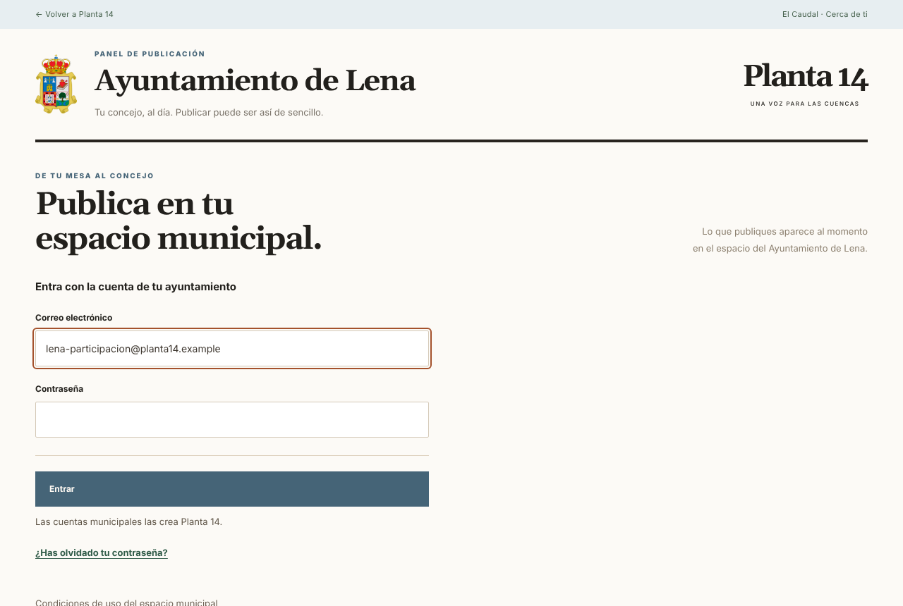

La cuenta te la da Planta 14 y es solo para ti: no la compartas. Si crees que alguien conoce tu contraseña, avísanos.

Al entrar, la sesión dura **14 días** y se alarga sola cada vez que usas el panel. Puedes abrirlo en varias pestañas o
desde un enlace de un correo sin volver a escribir la contraseña.

Las cuentas de los ayuntamientos solo funcionan en el panel: si intentas entrar en la zona de la redacción de Planta 14,
la web te indica la dirección de tu panel.

### Si has olvidado la contraseña

1. En la pantalla de entrada, pulsa **¿Has olvidado tu contraseña?**
2. Escribe tu correo y pulsa **Enviar el enlace**.
3. Recibirás un correo de Planta 14 con un enlace. Sirve **una sola vez** y caduca en **una hora**. Si no lo ves, mira
   en el correo no deseado.
4. El enlace abre tu panel. Escribe la contraseña nueva dos veces (al menos **12 caracteres**) y pulsa **Guardar y
   entrar**.

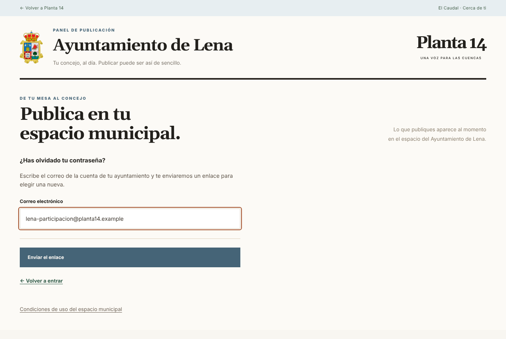

## 3. Las pestañas del panel

Arriba del panel hay siete pestañas:

| Pestaña | Para qué sirve |
|---|---|
| **Publicar** | Escribir un aviso, una noticia, un evento de la agenda, una ayuda o un anuncio. Es la que se abre al entrar. |
| **Mis publicaciones** | Ver lo publicado, editarlo, publicarlo o despublicarlo. |
| **Útil** | Elegir qué información útil sale en la página de tu concejo. |
| **Directorio** | Teléfonos, direcciones y horarios de los servicios del ayuntamiento. |
| **Sugerencias** | Contarnos qué servicios de Planta 14 os interesarían. |
| **Visitas** | Cuánta gente ve vuestro espacio este mes, con descarga en Excel o PDF. |
| **Ayuda** | Este manual, con buscador y descarga en PDF. |

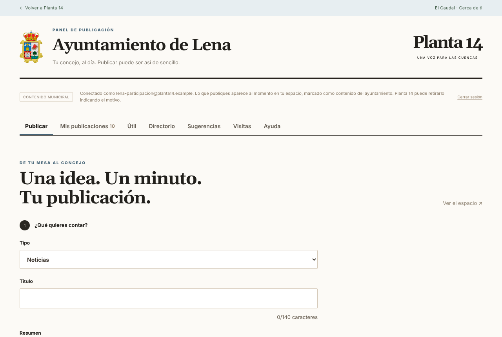

En el móvil, las pestañas van en una sola fila: desliza con el dedo hacia la izquierda para ver las demás.

## 4. Publicar

En la pestaña **Publicar**:

1. En **Tipo**, elige qué vas a publicar (ver la tabla).
2. Escribe el **Título** (hasta 140 caracteres) y un **Resumen** corto (hasta 300). Debajo ves cuántos llevas.
3. En **¿Qué deben saber los vecinos?**, escribe el texto completo.
4. Rellena los datos propios de ese tipo (fechas, lugar…).
5. Si quieres, añade una imagen (apartado 5).
6. Pulsa **Publicar ahora**: sale al momento en tu espacio.

| Tipo | Para qué | Datos propios | ¿Hasta cuándo se ve? |
|---|---|---|---|
| **Noticias** | Lo que ocurre en el concejo. | — | Hasta que la despublicas. |
| **Avisos** | Cortes de agua, obras, cambios de horario… | **Mostrar el aviso hasta** (opcional). | Hasta esa fecha; sin fecha, hasta que lo despublicas. |
| **Agenda** | Actos y eventos. | **Fecha**, **Hora** y **Lugar** (obligatorios). | Sale en la agenda hasta que pasa el evento. |
| **Ayudas y subvenciones** | Convocatorias para vecinos o empresas. | **Plazo de solicitud** y **Mostrar la ayuda hasta** (opcionales). | Hasta la fecha de «Mostrar la ayuda hasta»; sin fecha, hasta que la despublicas. |
| **Tablón de anuncios** | Anuncios oficiales y comunicados. | — | Hasta que lo despublicas. |

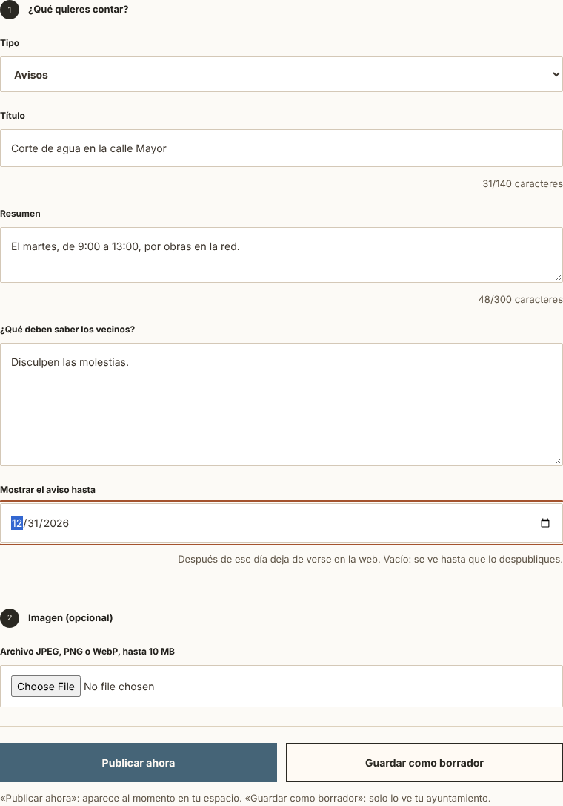

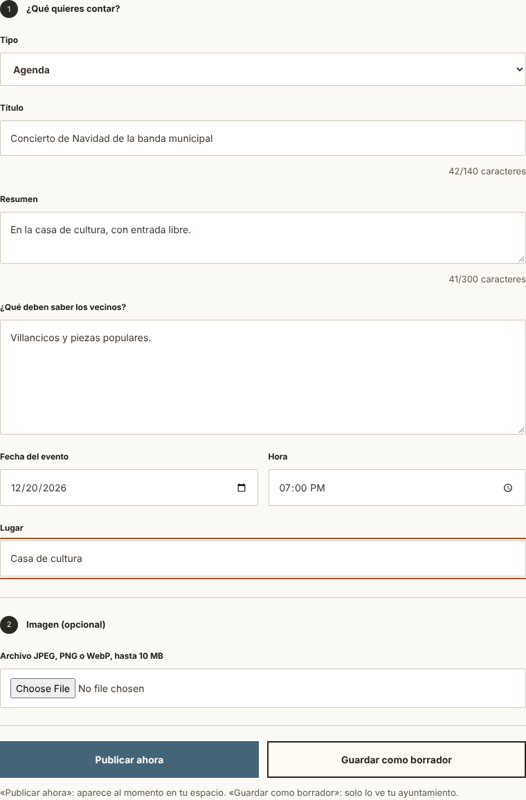

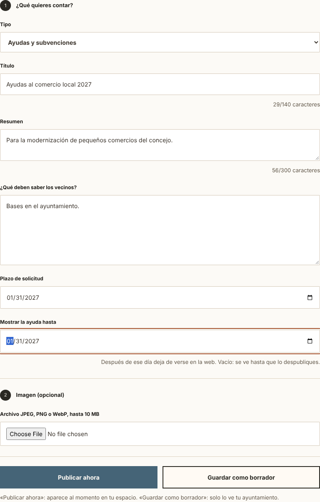

### Guardar como borrador

Si todavía no está listo, pulsa **Guardar como borrador** en lugar de «Publicar ahora». Solo lo ve tu ayuntamiento;
podrás terminarlo y publicarlo después desde **Mis publicaciones**.

## 5. Añadir una imagen

1. En **Imagen**, elige un archivo **JPEG, PNG o WebP** de hasta **10 MB**.
2. Escribe una **descripción** de lo que se ve (ayuda a las personas que no ven bien).
3. Escribe el **autor o crédito** de la foto (por ejemplo, «Ayuntamiento de Lena»).
4. Marca la casilla de **declaración de derechos**: el ayuntamiento confirma que puede publicar esa imagen (es suya o
   tiene permiso), que las personas que salen están de acuerdo y que el crédito es correcto. Sin la casilla, la imagen
   no se sube.

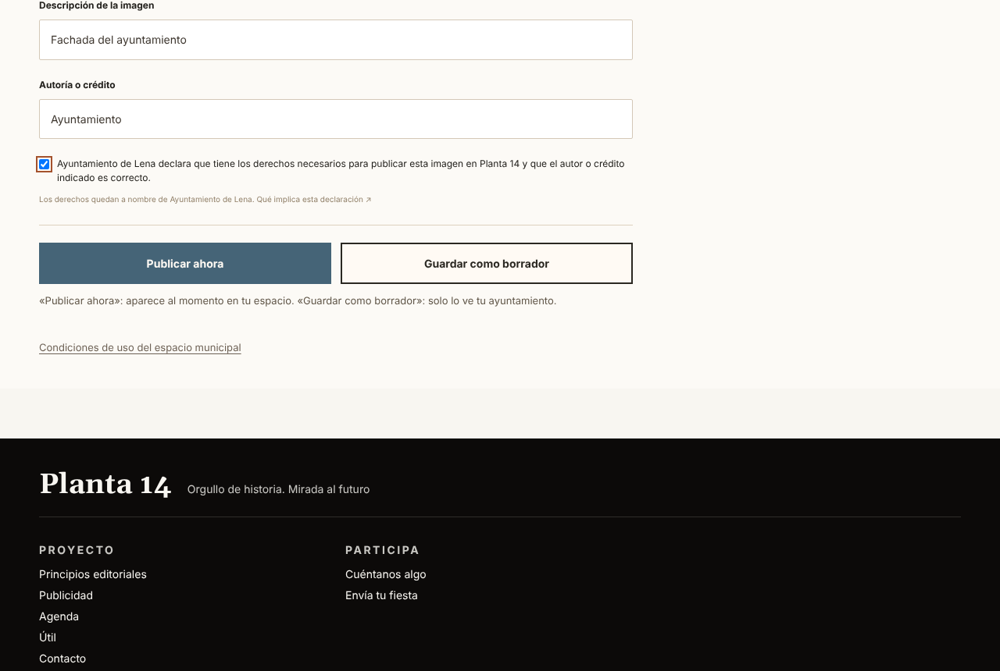

En caso de duda sobre una foto, no la subas: pregúntanos antes.

## 6. Editar, publicar y despublicar

En la pestaña **Mis publicaciones** ves todo lo que habéis publicado, de lo más reciente a lo más antiguo, 10 por
página. Arriba puedes filtrar por **tipo** y por **estado**:

- **Publicado:** se ve en la web.
- **Borrador:** solo lo ve tu ayuntamiento.
- **Publicado · cambios sin publicar:** has guardado cambios que todavía no se ven.
- **Retirado por Planta 14:** ver el apartado 11.

A la derecha de cada publicación tienes:

- **Editar:** la abre en la pestaña «Publicar». Cambia lo que necesites y pulsa **Publicar ahora** (o «Guardar como
  borrador»).
- **Publicar:** publica un borrador.
- **Despublicar:** la quita de la web sin borrarla. Puedes volver a publicarla cuando quieras.

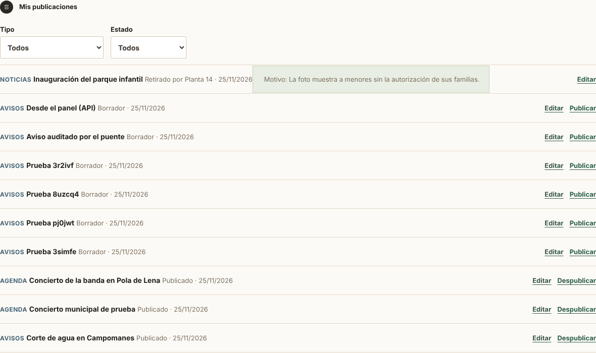

Así lo ven los vecinos, marcado como contenido del ayuntamiento:

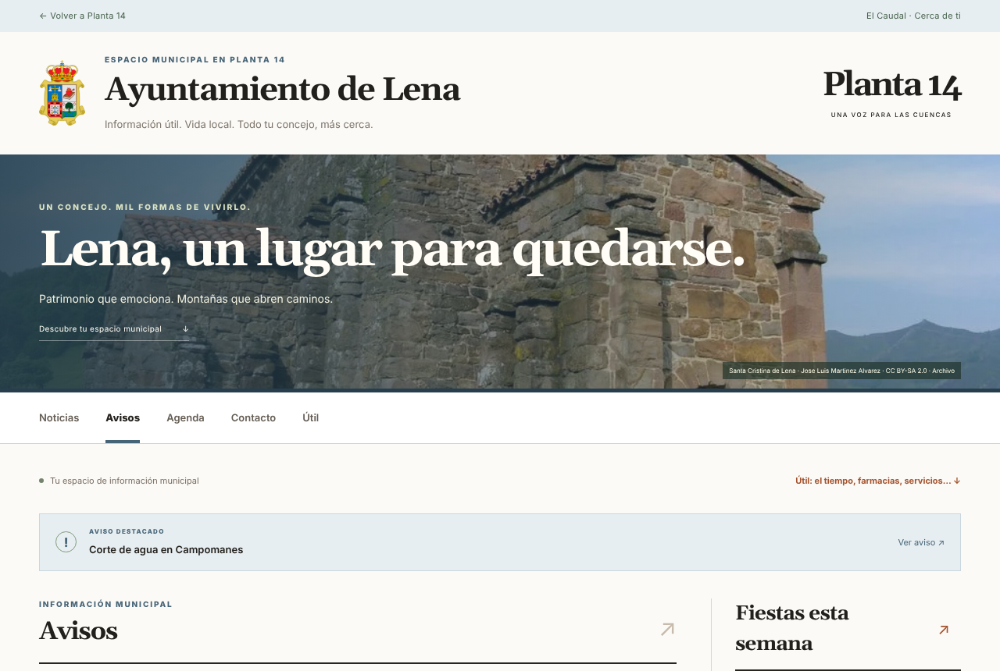

## 7. Ocultar información de «Útil»

La página de tu concejo tiene una sección **Útil**: el tiempo, puertos y estaciones de esquí, farmacias de guardia, el
directorio de servicios, patrimonio, rutas, subvenciones y empleo público. Por defecto sale todo.

En la pestaña **Útil**, desmarca lo que no quieras mostrar y pulsa **Guardar**. Se nota al momento en la web.

No se pueden ocultar las noticias ni los contenidos de Planta 14, ni el **índice de riesgo de incendios** de 112
Asturias, que sale siempre junto al tiempo por ser un dato de seguridad.

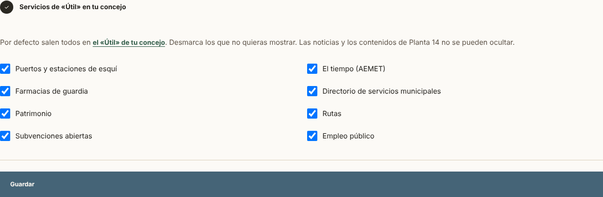

## 8. Mantener el directorio

En la pestaña **Directorio** está la lista de servicios del ayuntamiento (oficinas, biblioteca, polideportivo…), con un
buscador.

- **Añadir:** pulsa **Añadir servicio**, rellena el nombre, el tipo, la dirección, el teléfono, el correo, la web y lo
  demás que tengas, y pulsa **Añadir al directorio**.
- **Corregir:** pulsa **Editar** en su línea; el formulario se abre ahí mismo. Al terminar, pulsa **Guardar los
  cambios**.
- **Quitar:** pulsa **Quitar** en su línea.

Los cambios salen al momento en «Útil».

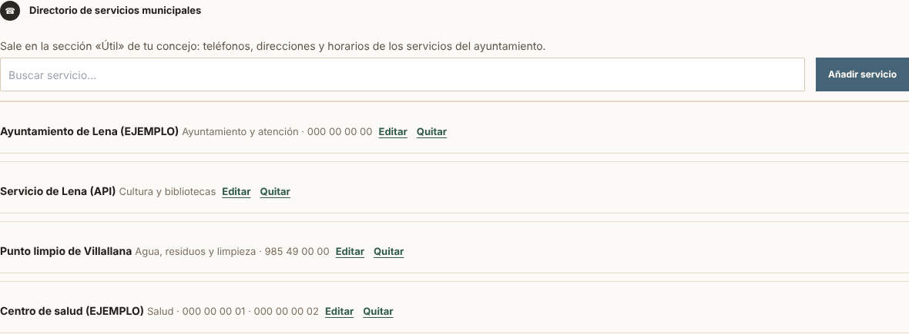

## 9. Enviar sugerencias

En la pestaña **Sugerencias**, marca los servicios de Planta 14 que os interesarían, cuéntanos lo que quieras y pulsa
**Enviar la sugerencia**. La lee la redacción de Planta 14, empezando por el periodista de vuestro concejo.

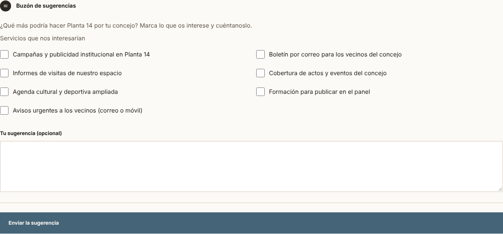

## 10. Consultar y descargar las visitas

En la pestaña **Visitas** ves cuánta gente visita vuestro espacio este mes:

- el **total** del mes y una barra por día (pasa el ratón por encima para ver la cifra);
- las **páginas más vistas**;
- de **dónde llegan** (buscadores, redes sociales, WhatsApp…);
- las **secciones** (Página del concejo, Útil, Sociedad, Cultura…).

Solo son las de tu concejo. Una noticia de Planta 14 sobre varios concejos cuenta en las visitas de cada uno.

Pulsa **Descargar CSV** para abrirlas en Excel o **Descargar PDF** para guardarlas o imprimirlas.

No usamos cookies ni guardamos datos personales de quien visita la web.

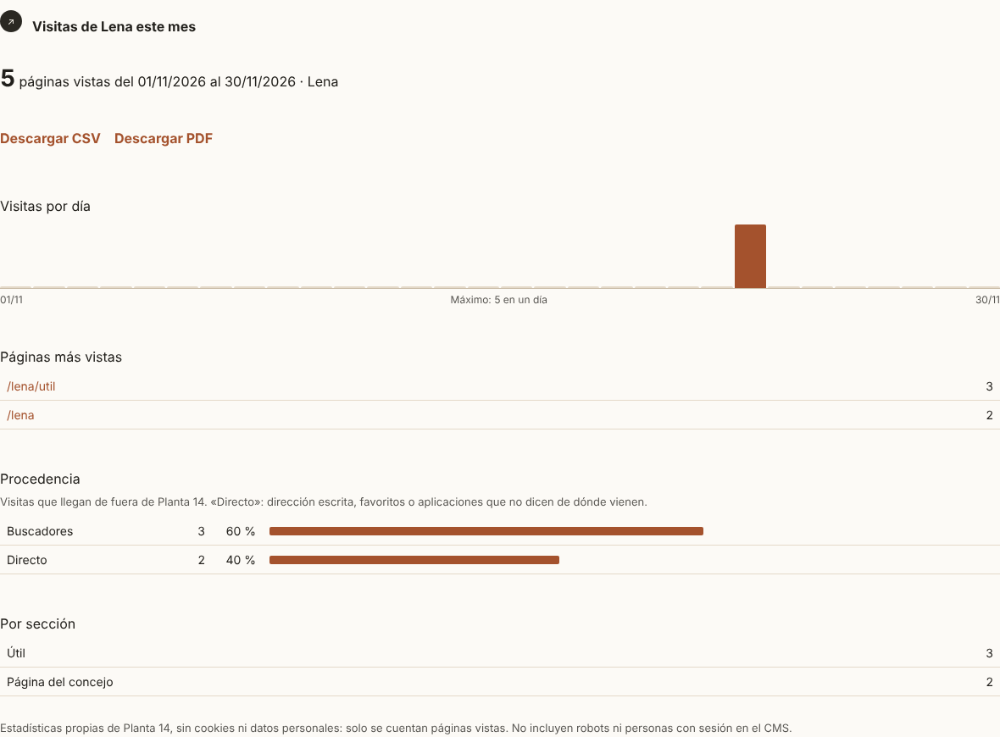

## 11. Normas: qué no se puede publicar y retiradas

En vuestro espacio **no se puede publicar**:

- contenido ilegal;
- publicidad ajena al ayuntamiento (por ejemplo, de empresas);
- propaganda electoral en periodo de campaña;
- datos personales que no hagan falta (teléfonos particulares, DNI, direcciones de vecinos);
- imágenes sin derechos o fotos de personas sin su permiso.

El ayuntamiento es responsable de que lo que publica sea cierto y legal.

Todo sale **marcado como contenido del ayuntamiento**. **Planta 14 puede retirar** una publicación si incumple estas
normas, las condiciones de uso o la ley, o si alguien reclama con razón. Entonces:

- deja de verse en la web al momento;
- en tu panel aparece como **Retirado por Planta 14**, con el **motivo**;
- no la publiques otra vez ni hagas una copia para evitar la retirada: escríbenos y lo resolvemos juntos.

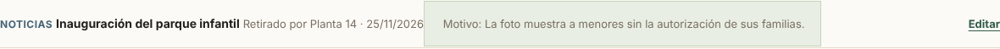

Las **Condiciones de uso del espacio municipal** completas están enlazadas al pie del panel.

## 12. Ayuda y cerrar sesión

En la pestaña **Ayuda** tienes este manual, con un buscador y el botón **Descargar en PDF**.

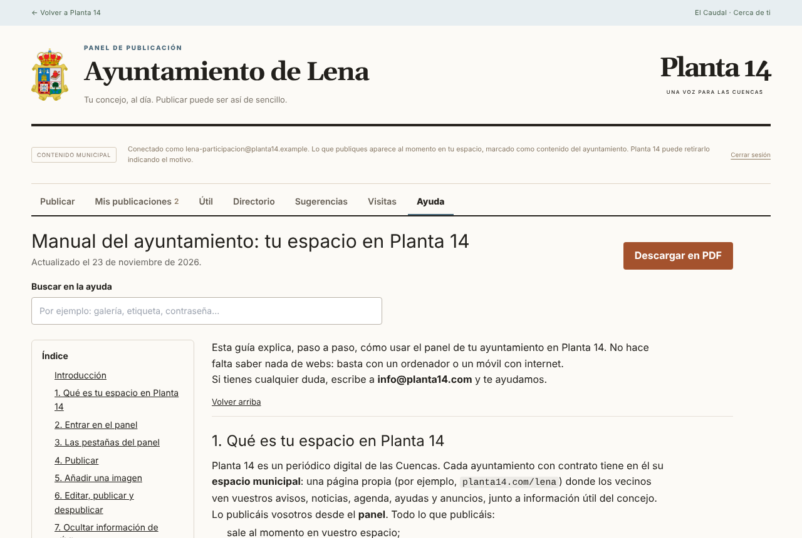

Al terminar, sobre todo en un ordenador compartido, pulsa **Cerrar sesión** (arriba del panel). Te saca del panel en
todas las pestañas.

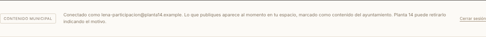

## 13. Dudas

Escribe a **info@planta14.com**. Cuéntanos tu concejo y lo que necesitas; si es sobre una publicación, di su título.
