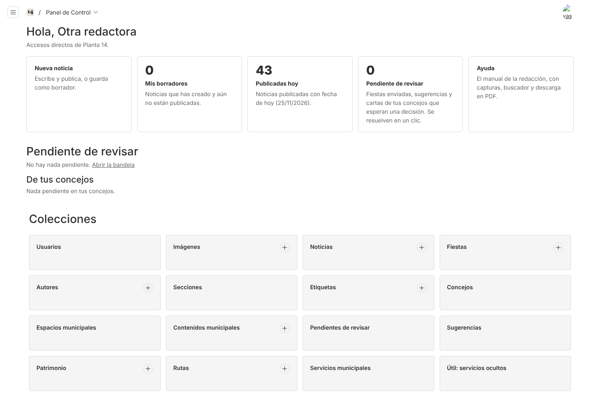
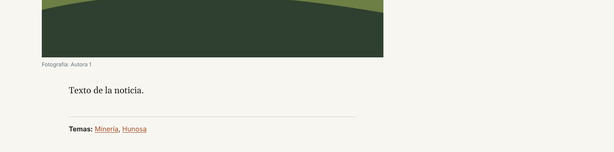
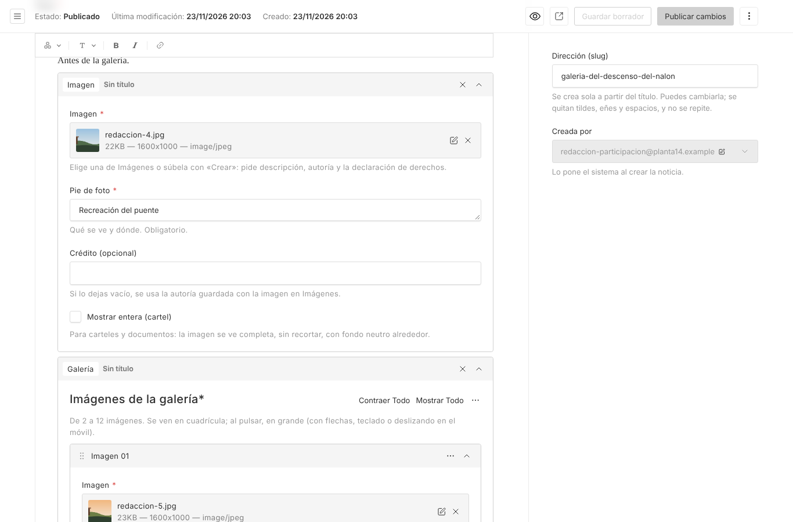
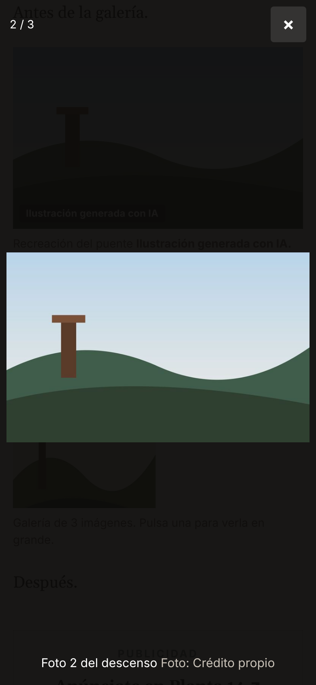
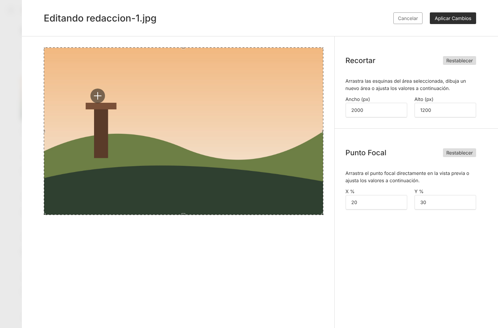
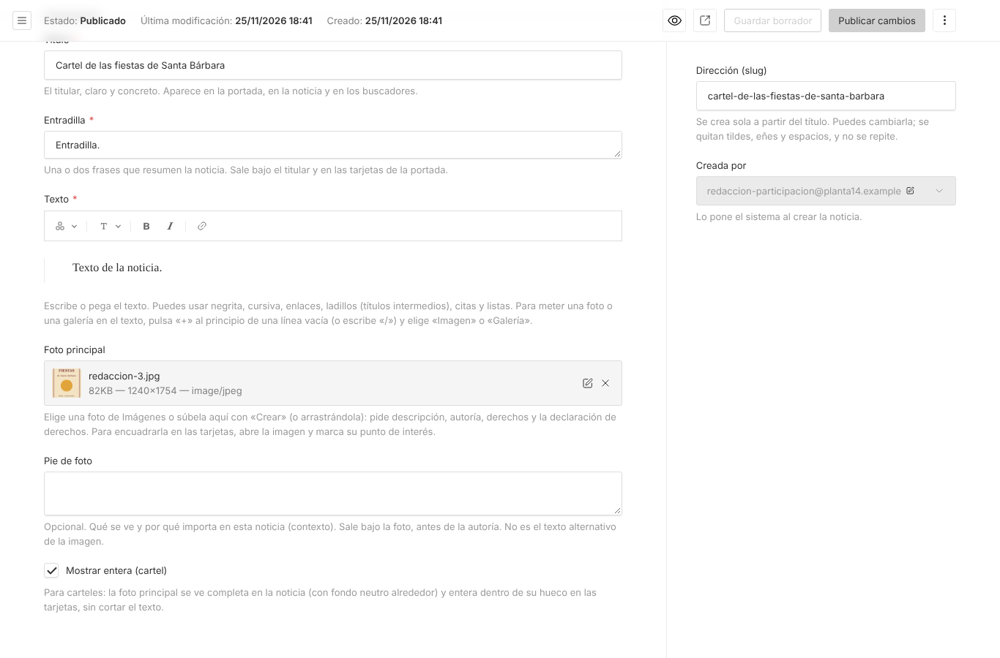
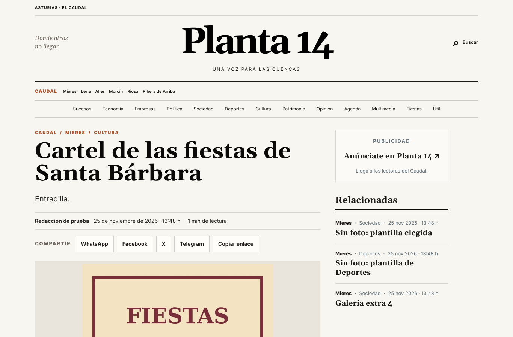
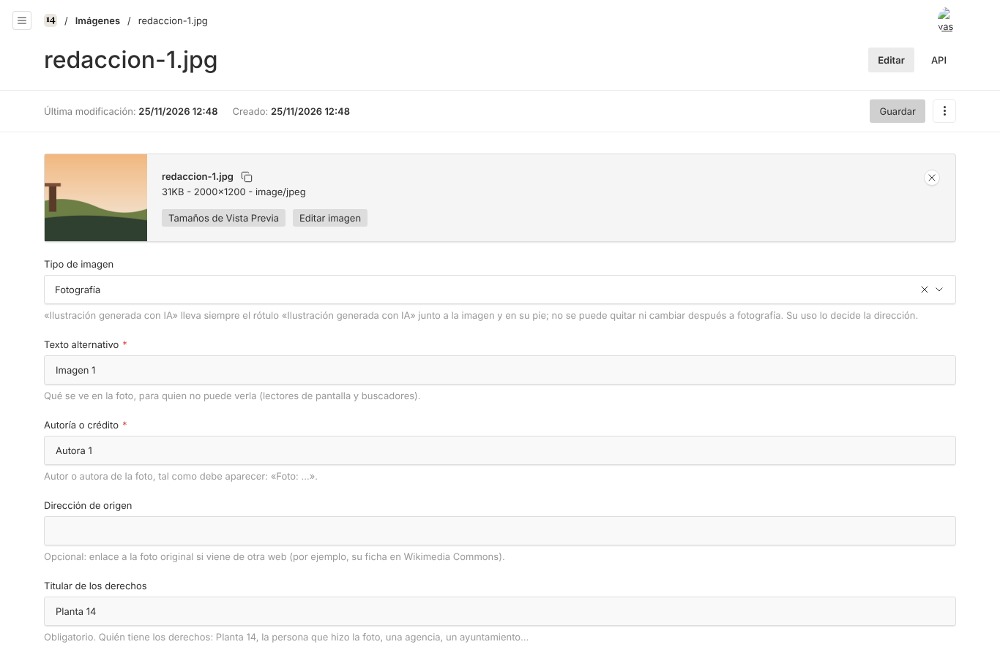
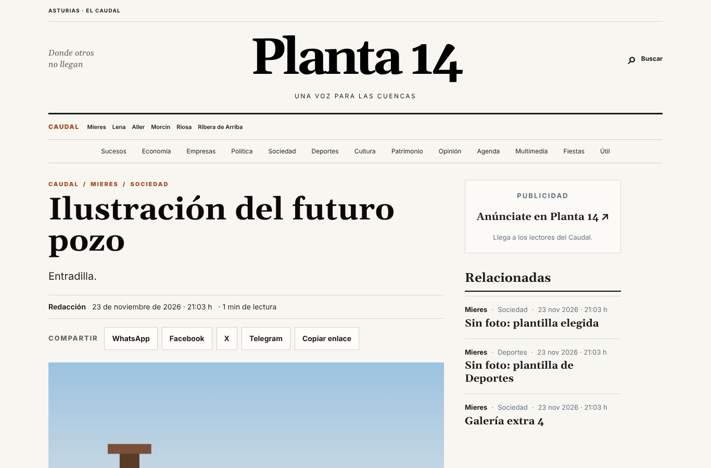
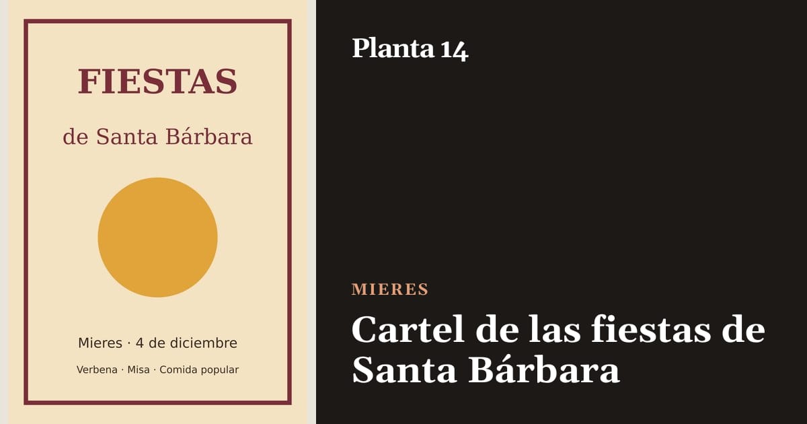

# Manual de la redacción

Para periodistas de Planta 14: cómo escribir, clasificar, ilustrar y publicar noticias en el CMS.

Lo único obligatorio en una noticia es **título, entradilla, texto, autor, concejo principal y sección principal**.
Todo lo demás es opcional y se puede dejar como está.

Si algo no funciona como dice este manual, escribe a **info@planta14.com**.

## 1. Entrar y el inicio

Entra en la zona de la redacción con tu correo y tu contraseña. Si la has olvidado, pulsa **¿Olvidaste tu
contraseña?** y sigue el enlace que te llega por correo (al menos 12 caracteres).

El **inicio** tiene accesos directos:

- **Nueva noticia:** abre el formulario vacío.
- **Mis borradores:** las noticias que has creado y aún no están publicadas.
- **Publicadas hoy.**
- **Pendiente de revisar:** fiestas enviadas, sugerencias y cartas de tus concejos que esperan una decisión.
- **Ayuda:** este manual, con buscador y descarga en PDF. También está en el menú de la izquierda.

## 2. El formulario de la noticia

Cada campo lleva debajo una ayuda breve. El formulario tiene seis pestañas:

| Pestaña | Qué hay |
|---|---|
| **Contenido** | Título, entradilla, texto (con fotos y galerías dentro), foto principal, «Mostrar entera (cartel)» y, si no hay foto, una plantilla de Planta 14. |
| **Clasificación** | Autor, concejo principal y otros concejos, sección principal y secundarias, etiquetas, «Es un artículo de opinión» y, solo para actividades, la fecha y el lugar de la **Agenda**. |
| **Portada** | **Principal** (la noticia grande de la portada), **Destacada** y **Mostrar en la página del concejo**. |
| **Publicación** | Fecha de publicación y publicación programada. |
| **Buscadores** | Título, descripción e imagen para Google y redes (opcionales). |
| **Fuente** | Solo si la noticia procede de otro medio o de una nota de prensa. |

A la derecha, la **dirección** de la noticia se crea sola a partir del título; no hace falta tocarla.

### El texto

Se escribe o se pega como en un procesador de textos. La barra de arriba tiene el desplegable **Texto normal** (para
convertir un párrafo en **Encabezado 2 / 3**, **Cita en bloque** o **lista**), **negrita**, *cursiva* y **enlace**.
Para meter una foto o una galería dentro del texto, mira el apartado 6.

### Publicar ya o programar

- **Fecha de publicación:** la que se ve en la noticia. Si la dejas vacía, se pone sola la hora a la que publiques. No
  puede ser futura.
- **Publicación programada (opcional):** elige día y hora y pulsa **Publicar cambios**: la noticia no se ve hasta esa
  hora y entonces sale sola.

### Vista previa

Guarda una vez con **Guardar borrador**. Arriba aparecen el **ojo** (vista previa al lado, en móvil, tableta u
ordenador) y la **Vista previa** en otra pestaña. Solo la ve quien tiene sesión en el CMS.

## 3. La firma

El **Autor** viene puesto si tu cuenta tiene una firma vinculada. Algunas cuentas tienen **firma fija** (por ejemplo,
las de la dirección, que firman como **El Director**): en ellas la firma viene puesta y es la única que se puede
elegir.

La firma sale bajo el titular, en las tarjetas de opinión y en los datos para buscadores.

## 4. Una noticia en varios concejos y secciones

Pestaña **Clasificación**:

| Campo | Para qué sirve |
|---|---|
| **Concejo principal** (obligatorio) | El concejo del que trata sobre todo. Es el que sale en la etiqueta de la noticia, en las migas («Caudal / Mieres / Sociedad») y en la imagen para redes. |
| **Otros concejos** (opcional) | Si la noticia también afecta a otros concejos. Sale también en sus páginas, en el boletín de quien sigue cualquiera de ellos y en sus estadísticas. No hace falta repetir el principal. |
| **Sección principal** (obligatoria) | Sociedad, Cultura, Deportes… Es la que se ve en la noticia. |
| **Secciones secundarias** (opcional, máximo 2) | La noticia sale también en la página de esas secciones. |

**«Caudal»** es la opción para lo que afecta a toda la comarca: sale en la portada y en la página del Caudal, no en
cada concejo. Con «Caudal» como principal no se pueden añadir otros concejos (el CMS lo avisa). Si afecta solo a dos o
tres concejos, mejor uno como principal y los demás en «Otros concejos».

En la web, la sección de cada noticia es un enlace a su página, en la noticia y en las tarjetas.

### Opinión

La casilla **Es un artículo de opinión** se marca sola al guardar cuando la sección principal o una secundaria es
**Opinión**, y se desmarca si la quitas. No hay que tocarla: así nunca queda una columna presentada como noticia ni al
revés.

## 5. Etiquetas (temas)

Las **etiquetas** agrupan noticias de distintas secciones y concejos sobre un mismo asunto: «minería», «Hunosa»,
«fiestas de San Juan»…

- En **Clasificación → Etiquetas**, escribe unas letras: aparecen las que ya existen. Elige una.
- Si no existe, pulsa **+** a la derecha del campo, escribe el nombre y guarda. Queda puesta en la noticia.
- No se repiten: «Minería», «mineria» y «MINERÍA» son la misma. Si intentas crear una que ya existe, el CMS te dice cuál
  usar.
- Como máximo **5** por noticia. Mejor pocas y que se repitan entre noticias.
- Escríbelas en minúscula, salvo los nombres propios.

En la web salen al pie de la noticia, enlazadas («Temas: minería, Hunosa»), y cada etiqueta tiene su página con todas
sus noticias. Google solo la muestra cuando tiene al menos 2 noticias.

La lista completa está en el menú, **Etiquetas**. Puedes corregir el nombre de una etiqueta (cambia en todas las
noticias).

## 6. Fotos y galerías dentro del texto

En el **Texto**, deja el cursor en una línea vacía y escribe **/** (o pulsa el **+** que aparece a la izquierda de la
línea). En el menú, elige **Imagen** o **Galería**.

- **Imagen:** una foto con **pie** (obligatorio) y **crédito** (si lo dejas vacío, se usa la autoría guardada con la
  foto). Si es un cartel o un documento, marca **Mostrar entera (cartel)**.
- **Galería:** de **2 a 12** fotos, cada una con su pie y su crédito. Pulsa **Añadir Imagen** para cada una. En la web
  se ven en cuadrícula; al pulsar una, se ve en grande y se pasa a la siguiente con las flechas, el teclado o deslizando
  el dedo en el móvil.

Las fotos del texto piden lo mismo que la principal: se eligen de **Imágenes** o se suben con **Crear**, con su
descripción, autoría y la casilla de derechos. Sin derechos, la noticia no se puede publicar.

 

## 7. La foto principal

En **Foto principal**, **Elegir de los existentes** abre la biblioteca de Imágenes. Si no tienes foto propia, la
biblioteca tiene fotos de paisaje de los concejos, cada una con su crédito, listas para usar. Para una foto nueva, pulsa
**Crear** (o arrástrala) y rellena:

- **Texto alternativo:** qué se ve en la foto;
- **Autoría o crédito:** cómo debe firmarse;
- **Titular** y **Tipo de derechos** (propia, con licencia, cedida, institucional);
- la casilla **«Declaro que Planta 14 tiene derecho a publicar esta imagen…»**. Sin ella, la noticia no se puede
  publicar con esa foto.

### Encuadre: el punto de interés

Las tarjetas y la portada recortan las fotos a lo ancho. Para que no se corten caras o lo importante:

1. Abre la foto (en **Imágenes**, o con el lápiz junto a la foto de la noticia).
2. Pulsa **Editar imagen**.
3. Arrastra el círculo **+** hasta lo importante (o escribe X % e Y % en **Punto focal**) y pulsa **Aplicar Cambios**.
4. **Guarda** la imagen.

Lo respetan todos los recortes: tarjetas, portada e imagen para redes.

**Fotos verticales:** dentro de la noticia se ven **enteras**, centradas y con una altura máxima, sin recortar (no hay
que hacer nada).

### Carteles: «Mostrar entera (cartel)»

Para carteles, programas o documentos (un A4 entero), marca **Mostrar entera (cartel)** bajo la foto principal (y en el
bloque **Imagen**). La imagen nunca se recorta: en la noticia se ve completa sobre fondo neutro y en las tarjetas,
completa dentro de su hueco, sin cortar el texto del cartel.

En **Fiestas**, el cartel se muestra entero **por defecto** (la casilla viene marcada). Desmárcala solo si es una foto
que se puede encuadrar.

### Sin foto: plantillas de Planta 14

Si no tienes foto, en **Contenido → Sin foto: plantilla de Planta 14** elige con un clic una de las plantillas gráficas
propias (una por sección y para Agenda, Formación, Ayudas, Empleo y Fiestas). Llevan el crédito «Planta 14». Si no
eliges ninguna, se usa la de la sección principal.

Son diseños propios: ni fotos ni ilustraciones de inteligencia artificial. En cuanto pongas una foto principal, la
plantilla deja de usarse.

### Imágenes hechas con IA

Se pueden usar, pero **poco**. La norma:

- **Solo como ilustración**, nunca algo que parezca una fotografía.
- Para **opinión, temas explicativos y piezas sin fecha** cuando no hay foto. **Nunca** para la noticia de un hecho
  concreto.
- **Nunca personas reales reconocibles**, ni lugares o hechos reales presentados como si fueran una fotografía.
- **Siempre** con el tipo **Ilustración generada con IA**, para que salga el rótulo, como exige la normativa europea.
- No hace falta pedir permiso antes: **decide cada redactor**.

Al subirla, en la imagen elige **Tipo de imagen → Ilustración generada con IA**. Entonces la web muestra **siempre** el rótulo «Ilustración generada con IA» encima de la imagen y en su pie (también en las tarjetas,
las galerías y la imagen para redes). No se puede quitar ni ocultar, nunca se presenta como «Fotografía» y, una vez
guardada así, no se puede cambiar a fotografía: si fue un error, hay que subir el archivo de nuevo.

Los otros tipos son **Fotografía** (por defecto) y **Gráfico, cartel o ilustración** hecho por personas.

## 8. Multimedia

Las noticias con al menos una galería salen en la página **Multimedia**, que aparece sola en el menú de secciones
cuando hay **6 o más**.

**Consejo:** pon también una **foto principal**; si no, la tarjeta de la galería lleva la plantilla de la sección.

## 9. Imagen para compartir en redes

Cada noticia tiene **automáticamente** su imagen para WhatsApp, Facebook, X y Telegram: la foto principal encuadrada
según su punto de interés (o la plantilla si no hay foto; si es un cartel, completo sobre fondo neutro), el titular, el
concejo principal y la marca Planta 14. No hay que hacer nada.

Si en **Buscadores → Imagen para redes** eliges otra foto, se usa esa foto con el mismo diseño. Si cambias el titular o
la foto, la imagen se renueva sola. WhatsApp y Facebook guardan su propia copia unas horas: un enlace ya compartido
puede tardar en cambiar.

## 10. Dudas frecuentes

- **¿Tengo que rellenar todo esto?** No. Solo lo obligatorio. Lo demás, cuando ayude.
- **La noticia no sale en un concejo:** comprueba «Otros concejos» y que «Mostrar en la página del concejo» (pestaña
  Portada) esté marcada.
- **No me deja publicar:** casi siempre es una foto (principal o del texto) sin la casilla de derechos. Ábrela y
  márcala.
- **He creado una etiqueta mal escrita:** ábrela en **Etiquetas** y corrige el nombre.
- **¿Dónde pongo el pie de foto de la foto principal?** La foto principal no lleva pie propio: debajo sale su
  **autoría o crédito**, que se cambia en la ficha de la imagen (el lápiz junto a la foto). El **Pie de foto** es de las
  fotos que añades dentro del texto con los bloques **Imagen** y **Galería**.
- **No puedo elegir otra firma:** tu cuenta tiene firma fija; habla con la administración.
- **¿Dónde está este manual?** En **Ayuda** (menú de la izquierda y tarjeta del inicio), con buscador y el botón
  **Descargar en PDF**. Si abres la Ayuda sin haber entrado en el CMS, primero te pide entrar y después te lleva a
  ella.

<!-- solo-administracion -->
## 11. Para la administración

Este apartado solo lo ve la administración.

- **CMS y panel municipal a la vez:** puedes tener abierto el panel de un concejo y el CMS en el mismo navegador;
  cada uno usa su propia sesión y no se molestan.
- **Firma fija:** en **Usuarios**, abre la cuenta, elige su **Firma (autor vinculado)** y marca **Firma fija**. Esa
  cuenta solo podrá firmar con ella. Las cuentas de la dirección (la de administración de Pablo y «Pablo Velasco
  (redactor)») firman como **El Director**.
- **Etiquetas:** solo la administración puede **borrar** una etiqueta (la redacción puede crearlas y corregirlas).
- **Imágenes hechas con IA:** las decide cada redactor, con la norma del apartado de fotos (poco, solo como
  ilustración y siempre con su tipo).
- **Campos internos:** el identificador de origen, la procedencia y el lote de la noticia, y los datos internos de
  imágenes, fiestas, patrimonio, rutas y servicios (identificadores de importación y datos de la copia pública de cada
  imagen) solo los ve la administración.
- **Cuentas municipales:** solo entran por el panel de su concejo. Si una intenta entrar en el CMS, se le indica la
  dirección de su panel. La administración las crea en **Usuarios**, con rol Ayuntamiento y su espacio municipal.
- **Estadísticas, espacios municipales, usuarios y motivos de rechazo:** tienen sus tarjetas en el inicio.
<!-- /solo-administracion -->
