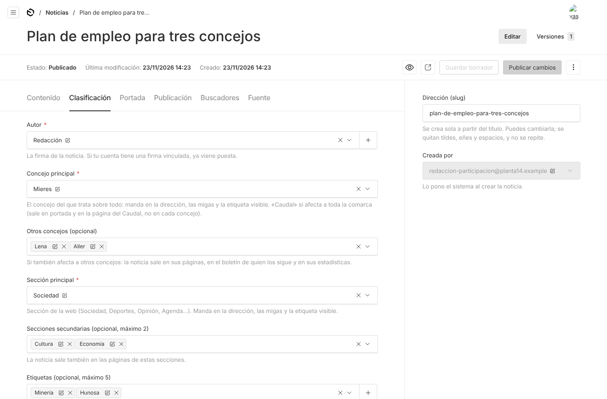
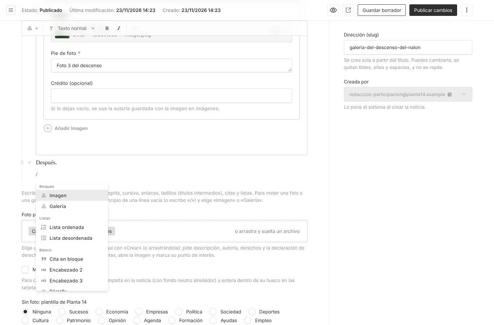
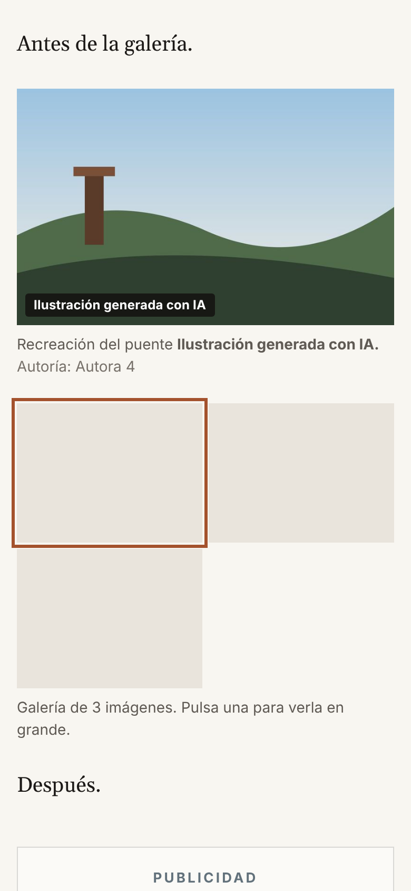
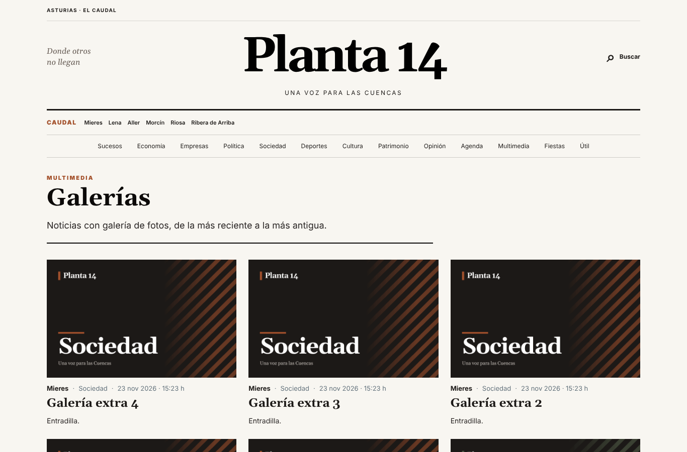
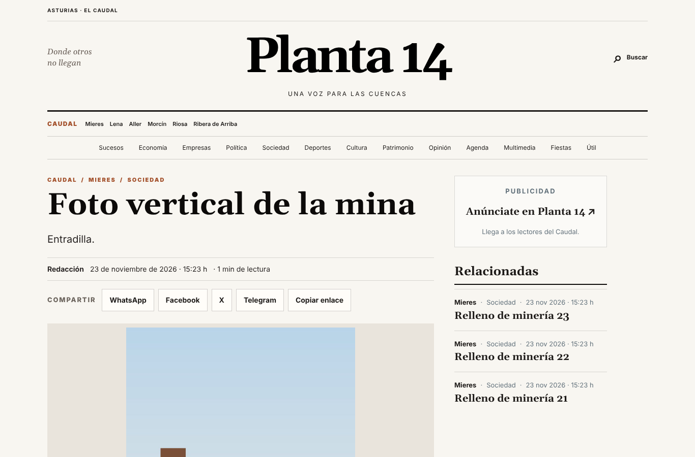
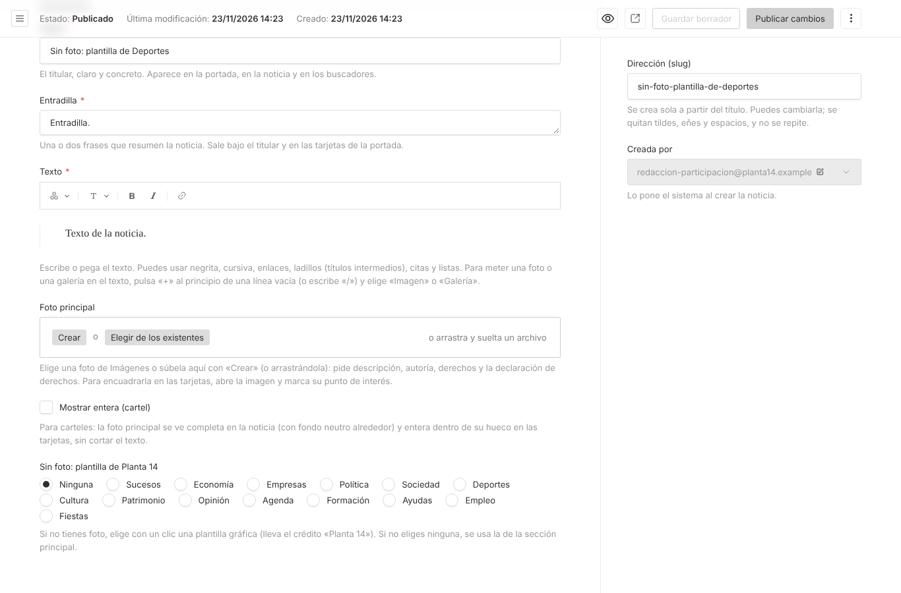
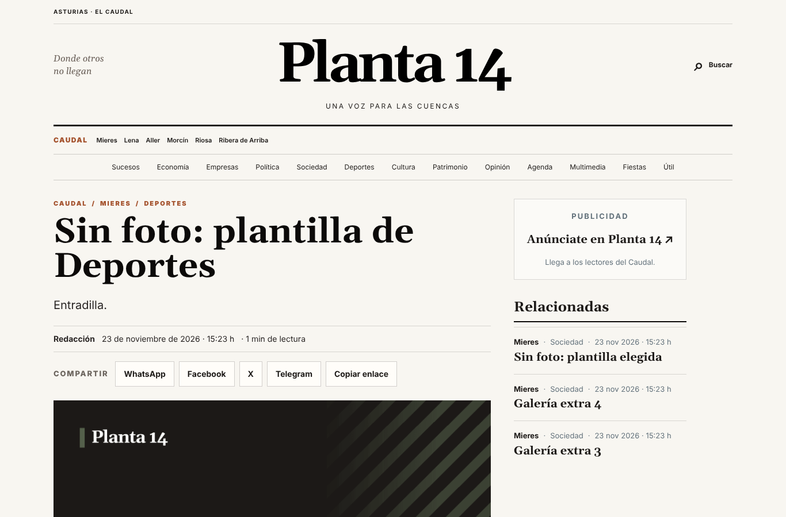
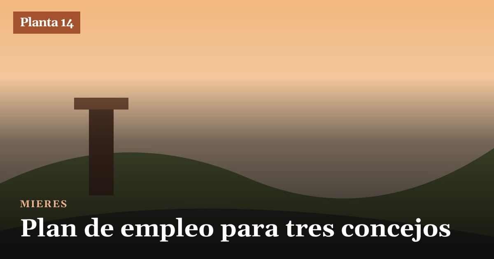

# Manual de la redacción: concejos, secciones, etiquetas e imágenes

Para periodistas de Planta 14. Lo básico del CMS (entrar, escribir, publicar, programar, vista previa) está en
`docs/MANUAL-OPERACION.md`, apartado 12. Aquí está lo nuevo de la entrega del 24 de noviembre.

Lo único obligatorio sigue siendo lo de siempre: **título, entradilla, texto, autor, concejo principal y sección
principal**. Todo lo demás de este manual es opcional y se puede dejar como está.

---

## 1. Una noticia en varios concejos y secciones

Pestaña **Clasificación**:

| Campo | Para qué sirve |
|---|---|
| **Concejo principal** (obligatorio) | El concejo del que trata sobre todo. Es el que sale en la etiqueta de la noticia, en las migas («Caudal / Mieres / Sociedad») y en la imagen para redes. |
| **Otros concejos** (opcional) | Si la noticia también afecta a otros concejos. Sale también en sus páginas, en el boletín de quien sigue cualquiera de ellos y en sus estadísticas. No hace falta repetir el principal. |
| **Sección principal** (obligatoria) | Sociedad, Cultura, Deportes… Es la que se ve en la noticia. |
| **Secciones secundarias** (opcional, máximo 2) | La noticia sale también en la página de esas secciones. |

**«Caudal»** sigue siendo la opción para lo que afecta a toda la comarca: sale en la portada y en `/comarca/caudal`,
no en cada concejo. Con «Caudal» como principal no se pueden añadir otros concejos (el CMS lo avisa). Si afecta solo a
dos o tres concejos, mejor uno como principal y los demás en «Otros concejos».

En la web, la sección de cada noticia es un enlace a su página (`/tema/sociedad`…), en la noticia y en las tarjetas.

## 2. Etiquetas (temas)

Las **etiquetas** agrupan noticias de distintas secciones y concejos sobre un mismo asunto: «minería», «Hunosa»,
«fiestas de San Juan», «Variante de Pajares»…

- En **Clasificación → Etiquetas**, escribe unas letras: aparecen las que ya existen. Elige una.
- Si no existe, pulsa **+** a la derecha del campo, escribe el nombre y guarda. Queda puesta en la noticia.
- No se repiten: «Minería», «mineria» y «MINERÍA» son la misma. Si intentas crear una que ya existe, el CMS te dice cuál
  usar.
- Como máximo **5** por noticia. Mejor pocas y que se repitan entre noticias.
- Escríbelas en minúscula, salvo los nombres propios.

En la web salen al pie de la noticia, enlazadas («Temas: minería, Hunosa»), y cada etiqueta tiene su página
`/etiqueta/mineria` con todas sus noticias. Google solo la indexa cuando tiene al menos 2 noticias.

La lista completa está en el CMS, **Etiquetas**. La redacción puede corregir un nombre (cambia en todas las noticias);
borrar una etiqueta solo puede hacerlo la administración.

## 3. Fotos y galerías dentro del texto

En el **Texto**, deja el cursor en una línea vacía y escribe **/** (o pulsa el **+** que aparece a la izquierda de la
línea). En el menú, elige **Imagen** o **Galería**.

- **Imagen:** una foto con **pie** (obligatorio) y **crédito** (si lo dejas vacío, se usa la autoría guardada con la
  foto). Si es un cartel o un documento, marca **Mostrar entera (cartel)**.
- **Galería:** de **2 a 12** fotos, cada una con su pie y su crédito. Pulsa **Añadir Imagen** para cada una. En la web
  se ven en cuadrícula; al pulsar una, se ve en grande y se pasa a la siguiente con las flechas, el teclado o deslizando
  el dedo en el móvil.

Las fotos del texto piden lo mismo que la principal: se eligen de **Imágenes** o se suben con **Crear**, con su
descripción, autoría y la casilla de derechos. Sin derechos, la noticia no se puede publicar.

 

## 4. Multimedia

Las noticias con al menos una galería salen en **`/multimedia`**. La página aparece sola en el menú de secciones
cuando hay **6 o más**; hasta entonces existe, pero no se enlaza ni la indexa Google.

**Consejo:** pon también una **foto principal**; si no, la tarjeta de la galería lleva la plantilla de la sección.

## 5. Encuadre: el punto de interés

Las tarjetas y la portada recortan las fotos a lo ancho. Para que no se corten caras o lo importante:

1. Abre la foto (en **Imágenes**, o con el lápiz junto a la foto de la noticia).
2. Pulsa **Editar imagen**.
3. Arrastra el círculo **+** hasta lo importante (o escribe X % e Y % en **Punto focal**) y pulsa **Aplicar Cambios**.
4. **Guarda** la imagen.

Lo respetan todos los recortes: tarjetas, portada e imagen para redes.

**Fotos verticales:** dentro de la noticia se ven **enteras**, centradas y con una altura máxima, sin recortar
(no hay que hacer nada).

## 6. Carteles: «Mostrar entera (cartel)»

Para carteles, programas o documentos (un A4 entero), marca **Mostrar entera (cartel)** bajo la foto principal (y en
el bloque **Imagen**). La imagen nunca se recorta: en la noticia se ve completa sobre fondo neutro y en las tarjetas,
completa dentro de su hueco, sin cortar el texto del cartel.

En **Fiestas**, el cartel se muestra entero **por defecto** (la casilla viene marcada). Desmárcala solo si es una foto
que se puede encuadrar.

## 7. Sin foto: plantillas de Planta 14

Si no tienes foto, en **Contenido → Sin foto: plantilla de Planta 14** elige con un clic una de las plantillas gráficas
propias (una por sección y para Agenda, Formación, Ayudas, Empleo y Fiestas). Llevan el crédito «Planta 14». Si no
eliges ninguna, se usa la de la sección principal.

Son diseños propios: ni fotos ni ilustraciones de IA. En cuanto pongas una foto principal, la plantilla deja de usarse.

## 8. Ilustraciones generadas con IA

Su uso lo decide **la dirección**. El CMS solo deja la opción preparada:

- En la imagen, **Tipo de imagen → Ilustración generada con IA**.
- Entonces la web muestra **siempre** el rótulo «Ilustración generada con IA» encima de la imagen y en su pie (también
  en las tarjetas, las galerías y la imagen para redes). No se puede quitar ni ocultar.
- Nunca se presenta como «Fotografía». Una vez guardada como IA, no se puede cambiar a fotografía; si fue un error, hay
  que subir el archivo de nuevo.

Los otros tipos son **Fotografía** (por defecto) y **Gráfico, cartel o ilustración** hecho por personas.

## 9. Imagen para compartir en redes

Cada noticia tiene **automáticamente** su imagen para WhatsApp, Facebook, X y Telegram (1200×630): la foto principal
encuadrada según su punto de interés (o la plantilla si no hay foto; si es un cartel, completo sobre fondo neutro), el
titular, el concejo principal y la marca Planta 14. No hay que hacer nada.

Si en **Buscadores → Imagen para redes** eliges otra foto, se usa esa foto con el mismo diseño. Si cambias el titular o
la foto, la imagen se renueva sola. WhatsApp y Facebook guardan su propia copia unas horas: un enlace ya compartido
puede tardar en cambiar.

## 10. Dudas frecuentes

- **¿Tengo que rellenar todo esto?** No. Solo lo obligatorio de siempre. Lo demás, cuando ayude.
- **La noticia no sale en un concejo:** comprueba «Otros concejos» y que «Mostrar en la página del concejo» (pestaña
  Portada) esté marcada.
- **No me deja publicar:** casi siempre es una foto (principal o del texto) sin la casilla de derechos. Ábrela y
  márcala.
- **He creado una etiqueta mal escrita:** ábrela en **Etiquetas** y corrige el nombre.
